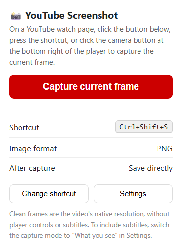

# YouTube Screenshot — Video Frame Capture

**English** | [简体中文](README.zh-CN.md)

Capture the current YouTube video frame in one click, without pausing playback. Chrome MV3 (the source is also compatible with Safari Web Extensions).

## Settings

## Two language versions

| Folder | UI language |
|---|---|
| `en/` | English |
| `zh-CN/` | 简体中文 (Simplified Chinese) |

Both versions have identical features; each folder is a complete, self-contained extension with its own detailed README.

## Download

Go to **Releases** and download the build you want:

- `YouTube-Screenshot-v1.0-EN.zip` — English
- `YouTube-Screenshot-v1.0-CN.zip` — 简体中文 (Simplified Chinese)

## Install in Chrome

1. Unzip the release archive (or clone this repo).
2. Open `chrome://extensions` and turn on **Developer mode** (top right).
3. Click **Load unpacked** and select the extension folder — the unzipped release folder, or the `en` / `zh-CN` folder of this repo.
4. Open any YouTube video: a camera button appears at the bottom right of the player.

## Safari (Mac)

Safari can't install the zip directly. On a Mac with Xcode (free in the App Store), wrap either language folder with Apple's official converter:

1. Run in Terminal: `xcrun safari-web-extension-converter /path/to/en` (or `zh-CN` for the Chinese version).
2. Open the generated Xcode project and click Run (▶) once — this registers the extension with Safari.
3. In Safari, go to Settings → Extensions, enable "YouTube Screenshot", and allow it to access youtube.com.

No paid Apple Developer account is needed for personal use on your own Mac. Full details are in each folder's own README.

## Features

- Three capture entries: player camera button, keyboard shortcut (`Ctrl+Shift+S` by default), toolbar popup — none of them pause playback.
- Clean-frame mode grabs the native resolution with no player controls or subtitles; "what you see" mode includes subtitles.
- After capture: preview, save directly, or copy to clipboard. PNG / JPG / WebP.
- Works on Shorts and while paused. If the tab was opened before the extension was installed, the script injects itself automatically — no page refresh needed.

## Limits

DRM-protected video (Netflix, Disney+, paid YouTube movies) is blacked out by the browser itself — no extension can capture it. Regular YouTube videos are unaffected. Subtitles are a page overlay, not part of the video picture; use "what you see" mode if you want them in the image.

## License

MIT — see [LICENSE](LICENSE).
