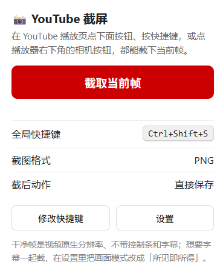

# YouTube 截屏 — Video Screenshot

[English](README.md) | **简体中文**

一键截取 YouTube 当前视频帧，不用暂停播放。Chrome MV3（源码同样兼容 Safari Web Extension）。

## 设置

## 两个语言版本

| 文件夹 | 界面语言 |
|---|---|
| `en/` | 英文 (English) |
| `zh-CN/` | 简体中文 |

两版功能完全相同，每个文件夹都是完整独立的插件，内有各自语言的详细说明。

## 下载

到 **Releases** 下载需要的版本：

- `YouTube-Screenshot-v1.0-EN.zip` — 英文
- `YouTube-Screenshot-v1.0-CN.zip` — 简体中文

## 在 Chrome 里安装

1. 解压 Release 压缩包（或 clone 本仓库）。
2. 打开 `chrome://extensions`，打开右上角的**开发者模式**。
3. 点**加载已解压的扩展程序**，选择插件文件夹 — 解压出来的文件夹，或本仓库的 `en` / `zh-CN` 文件夹。
4. 打开任意 YouTube 视频，播放器右下角会出现相机按钮。

## Safari (Mac)

Safari 不能直接装 zip。在装了 Xcode 的 Mac 上（App Store 免费下载），用苹果官方转换器把任意一个语言文件夹包一层 App 外壳：

1. 终端运行：`xcrun safari-web-extension-converter /路径/en`（中文版用 `zh-CN` 文件夹）。
2. 用 Xcode 打开生成的工程，点 Run（▶）运行一次，扩展就注册进 Safari 了。
3. 打开 Safari → 设置 → 扩展，勾选启用「YouTube Screenshot」，并允许它访问 youtube.com。

个人在自己 Mac 上自用不需要付费开发者账号。详细步骤见各语言文件夹内的 README。

## 功能

- 三种截屏入口：播放器相机按钮、快捷键（默认 `Ctrl+Shift+S`）、工具栏弹窗 — 都不暂停播放。
- 干净帧模式按原生分辨率抓帧，无控制条、无字幕；「所见即所得」模式带字幕。
- 截后可选：先预览、直接保存、或复制到剪贴板。PNG / JPG / WebP。
- 支持 Shorts 和暂停状态；标签页在装插件之前就打开了也能直接截，脚本会自动注入，不用刷新页面。

## 限制

DRM 保护的视频（Netflix、Disney+、YouTube 付费电影）会被浏览器本身黑屏，任何插件都截不了；普通 YouTube 视频不受影响。字幕是网页浮层、不属于视频画面本身，想带字幕请用「所见即所得」模式。

## 许可证

MIT — 见 [LICENSE](LICENSE)。
