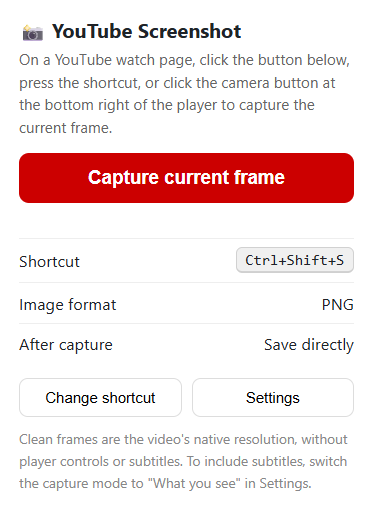

# YouTube Screenshot - Video Frame Capture

A browser extension for capturing the current video frame while watching YouTube (Chrome MV3; the source is also compatible with Safari Web Extensions).

## Features

- **Three ways to capture, one click each** (none of them pause playback):
  1. The camera button added at the bottom right of the player (to the left of the settings gear)
  2. A keyboard shortcut, `Ctrl+Shift+S` by default (Mac: `Control+Shift+S`), which you can change at `chrome://extensions/shortcuts`
  3. Click the toolbar icon, then "Capture current frame" in the popup
- **Two capture modes:**
  - Clean frame (default): draws the video frame straight to a canvas at its **native resolution** (a 4K video gives a 4K image), with no player controls, subtitles or mouse cursor. If the browser blocks frame capture for a particular video, it automatically falls back to "What you see".
  - What you see: takes a screenshot of the viewport and crops it to the video's position, so **subtitles are included**. Resolution is limited by the window size (fullscreen gives the best result).
- **Three after-capture actions** (switch in Settings): preview first (then choose save or copy), save directly, or copy to clipboard (if copying fails, the preview opens instead so the image isn't lost).
- **Formats:** PNG / JPG / WebP, with adjustable JPG/WebP quality. Copying to the clipboard always uses PNG.
- **Automatic file names:** `video-title_video-time_date-time.ext`, e.g. `Some Tutorial_12-34_20261114_145501.png`.
- Works on Shorts and while paused.

## Install in Chrome (load unpacked)

1. Unzip the archive to get the `youtube-screenshot-extension` folder.
2. Open `chrome://extensions` in Chrome and turn on "Developer mode" (top right).
3. Click "Load unpacked" and select that folder.
4. Open any YouTube video; a camera button appears at the bottom right of the player. Pinning the extension to the toolbar is recommended.

## Install in Safari (requires a Mac with Xcode)

This is a standard Web Extension. Safari can't install a zip directly, so you wrap it in an app shell with Apple's official converter:

1. Install Xcode from the Mac App Store (free).
2. Copy the `youtube-screenshot-extension` folder to your Mac and run this in Terminal:
   `xcrun safari-web-extension-converter /path/to/youtube-screenshot-extension`
   (Follow the prompts to generate an Xcode project; choose Swift and any name.)
3. Open the generated project in Xcode and click Run (▶) once; this registers the extension with Safari.
4. In Safari, go to Settings → Extensions, enable "YouTube Screenshot", and allow it to access youtube.com.
5. Usage is then the same as in Chrome (player camera button, popup button). Note: in Safari, shortcuts are governed by Safari's extension settings; if the shortcut doesn't work after conversion, use the player button.

The whole conversion needs no paid developer account for personal use on your own Mac; you only need an Apple Developer account to sign it for distribution to others.

## Limits (important)

- **DRM content can't be captured:** DRM-protected video such as Netflix, Disney+ and paid YouTube movies is blacked out by the browser. This affects every extension and can't be worked around. Regular YouTube videos are not affected.
- **Subtitles** are not part of the video picture itself (they are a web-page overlay), so a clean frame not containing them is expected. Use "What you see" mode if you want subtitles.
- A clean frame's sharpness depends on the resolution the video is actually loaded at: select 1080p in the player to get a 1080p capture; if auto quality has dropped to 480p, you get 480p. Before capturing something important, set the quality you want and let it buffer.

## File structure

- `manifest.json` — MV3 configuration; declares the commands shortcut and the content script
- `content.js` / `content.css` — injected into YouTube: player button, frame capture, preview overlay, toasts
- `background.js` — shortcut forwarding and the captureVisibleTab fallback screenshot
- `popup.html/js` — toolbar popup: capture button, current settings, shortcuts to other pages
- `options.html/js` — settings page: capture mode, after-capture action, format and quality

## Changelog

### 1.0

Fixes:
- **Preview mode (the default) errored on every capture:** an inner function in `showPreview` had the same name as the outer `closePreview`. It was hoisted and shadowed the outer function, so its first-line call touched uninitialized variables and threw `Cannot access 'wrap' before initialization`; the preview never appeared. Renamed to fix it.
- **Preview and toasts were invisible in fullscreen:** the overlays were attached under `<html>`, but in fullscreen only the fullscreen element's subtree is visible. They are now attached to the fullscreen element.
- **In "What you see" mode, the previous capture's toast/preview ended up in the next image:** overlays are now hidden at the moment of capture.
- **"Copy to clipboard" always failed when triggered from the popup:** the popup held focus, and clipboard writes are rejected when the page isn't focused. The popup now closes right after you click, and the page waits for focus before writing.
- **The shortcut did nothing on YouTube tabs opened before the extension was installed or updated:** the script is now injected automatically; if that still fails, the toolbar icon shows a red `!`.
- **Old buttons stopped working after an extension reload:** a button left behind by an old instance is replaced by the new one, and the old script shuts itself down.
- **Player button injection could throw:** if the settings button isn't a direct child of `.ytp-right-controls`, `insertBefore` throws `NotFoundError`. The button is now inserted into the settings button's own parent.

Improvements:
- The "is the canvas tainted" probe now reads 1 pixel instead of calling `toDataURL` (which encoded a whole PNG and froze the page on 4K).
- With several `<video>` elements on a page, the one with the largest visible area is used; the player button captures the video in its own player.
- DOM-change monitoring is throttled, and the 2-second polling is gone.
- YouTube pages are detected by hostname (the old regex also matched things like `notyoutube.com`).
- `captureVisibleTab` only runs when the requesting page is the active tab, so it can't capture a different page.
- The file extension follows the format actually encoded (browsers without WebP encoding fall back to PNG).
- An unread-count prefix such as `(3) ` is removed from titles.
- Permissions: removed the unused `downloads`; added `scripting` (used only for the injection described above).

Version: 1.0
